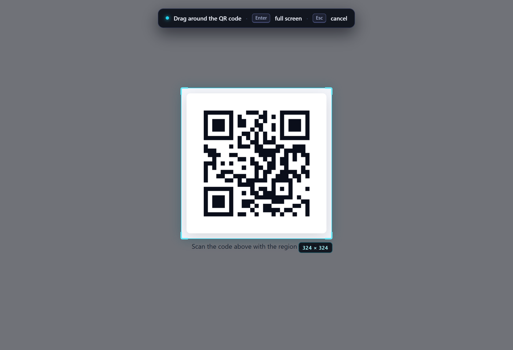
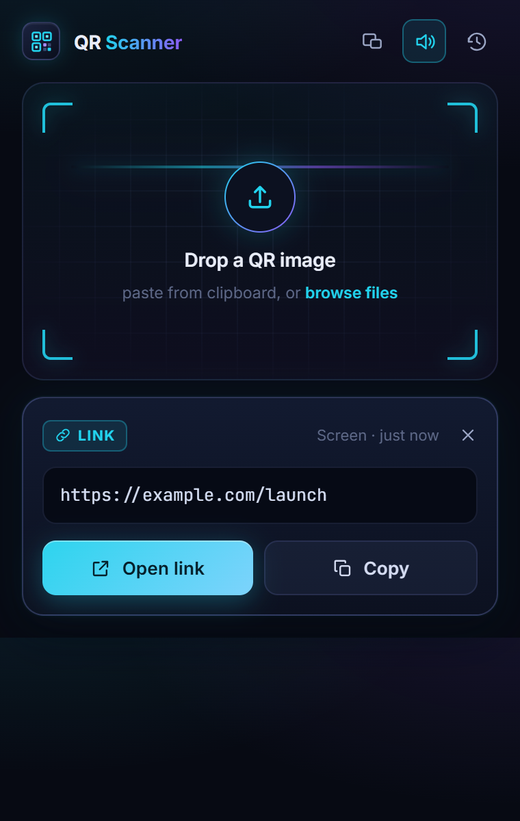
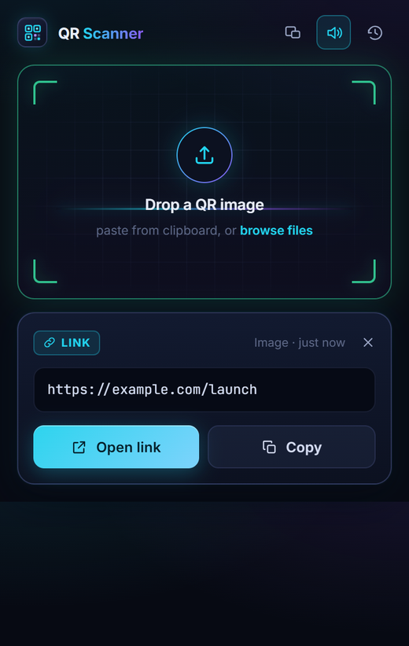
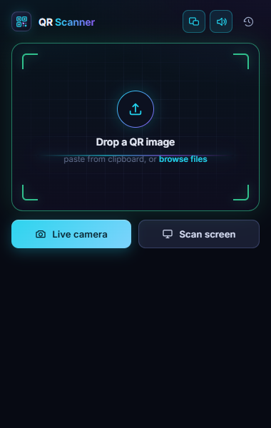
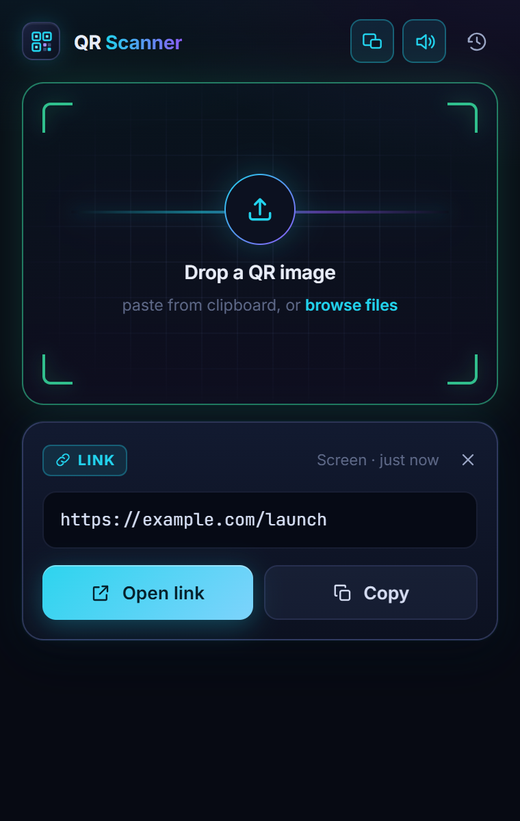
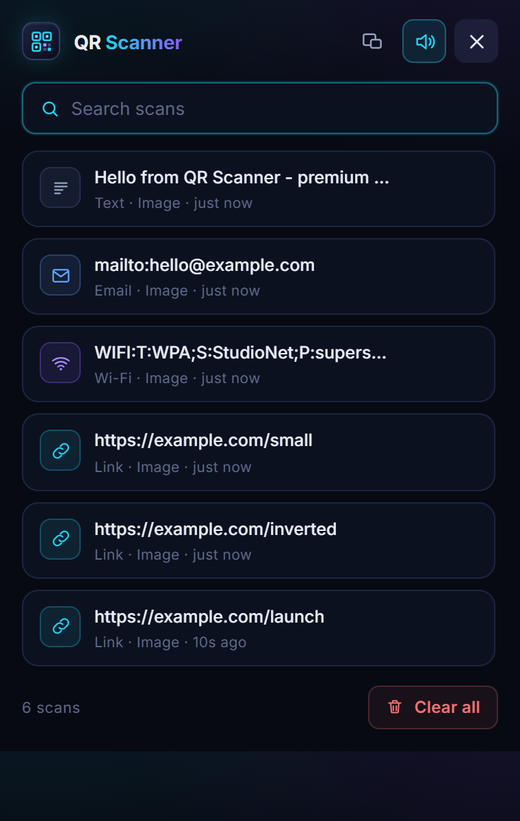
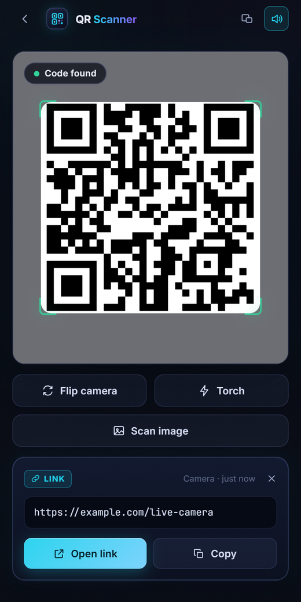
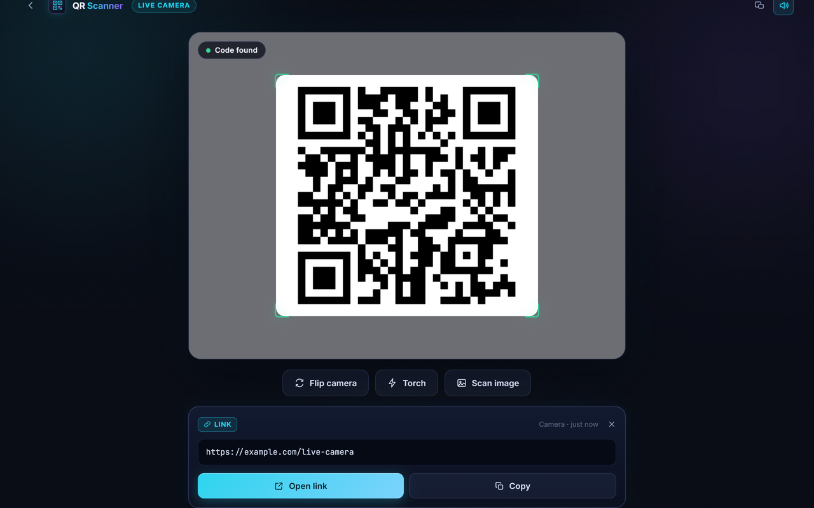

# QR Scanner — Chrome Extension

> Scan QR codes your way: live camera, image upload, paste, or snip any region of the page — the crop is decoded automatically. Detach the scanner into a floating always-on-top window. Detects links, Wi-Fi, email, SMS, contacts and 2FA keys, with searchable history, one-tap copy/open and sound alerts. Fully offline, no tracking, minimal permissions.

A premium, privacy-first QR scanner for **Google Chrome** and **Chromium** browsers. Manifest V3, zero network calls, everything decoded on your machine.

---

## Screenshots

Every image below is captured by the automated end-to-end suite running the real unpacked
extension — no mockups or staged renders.

### Select region — snip a QR code straight off the page

Drag a box around any code on the active tab; the crop is captured, decoded and delivered
with no manual screenshot, upload or paste. `Enter` grabs the whole screen, `Esc` cancels.



| **Result from the screen**<br>Source badge reads `Screen` | **Result from an image**<br>Type badge, Open link / Copy | **Floating window**<br>Detached, always on top |
|:--:|:--:|:--:|
|  |  |  |
| **Live delivery to the float**<br>Results arrive while it is open | **Searchable history**<br>Type badges, source, Undo | **Narrow viewport**<br>390 px wide, no overflow |
|  |  |  |

### Live camera scanner

A dedicated tab with viewfinder overlay, torch, front/rear flip and de-duplicated continuous
decoding.



---

## Core features

| Feature | What it does |
| --- | --- |
| **Region snip capture** | Click **Select region**, drag a box around any QR code on the active webpage (snipping-tool style). The crop is captured, cropped at your display's pixel ratio and decoded automatically — no manual screenshot, no paste. Press `Enter` for the full screen, `Esc` to cancel. |
| **Live camera scan** | Continuous camera decoding with a viewfinder overlay, torch, front/rear flip and graceful fallback when no camera exists. Repeat detections are de-duplicated. |
| **Image scan** | Drop an image, click to browse, or `Ctrl/Cmd+V` paste straight from the clipboard. Inverted and small (132 px) codes are handled. |
| **Floating window** | Detach the scanner into a borderless always-on-top popup window that shares the same history, and run the live camera inside it. |
| **Smart payload handling** | Recognises links, Wi-Fi, email, phone, SMS, geo, vCard contacts, calendar events and `otpauth://` 2FA keys, then offers the right primary action — **Open link / Compose / Call / Open map / Copy**. |
| **Searchable history** | Last 100 scans with type badges, source (`Screen`, `Camera`, `Image`), relative timestamps, delete with **Undo**, clear with **Undo**, and instant search. |
| **Result delivery** | If the scanner is open, results appear instantly. If it is closed, the toolbar badge lights up and the result is waiting when you reopen it. |
| **Sound feedback** | Two-tone success chime with a visible mute toggle (respects your choice across sessions). |
| **Premium UI/UX** | Obsidian/cyan/violet design system, bundled Inter + JetBrains Mono, custom scrollbars, scanline animation, full `prefers-reduced-motion` support, no clutter. |

## Privacy & permissions

Only three Manifest V3 permissions — nothing more:

- `storage` — your scan history and sound preference
- `activeTab` — capture and select a region on the tab you are looking at, only after you click
- `scripting` — inject the region-selection overlay into that same tab

There are **no host permissions, no analytics, no remote code, no background polling, and no network requests**. QR decoding uses a bundled copy of jsQR running locally.

---

## Installation

### Google Chrome (step by step)

1. **Get the files** — either download the ZIP from the repository (`Code` → `Download ZIP`) and extract it, or clone it:
   ```bash
   git clone https://github.com/manjayofficial01-ui/QR-Scanner-chrome-extension.git
   ```
   Extracting gives you a folder containing `manifest.json`, `popup.html`, `js/`, `css/`, `icons/`, etc.
2. **Open the extensions page** — click the address bar, type the following and press Enter:
   ```
   chrome://extensions
   ```
3. **Enable Developer mode** — toggle the switch in the **top-right corner** of the page.
4. **Load the unpacked extension** — click the **Load unpacked** button that appears in the **top-left corner**.
5. **Select the folder** — choose the extracted project folder itself (the one where `manifest.json` lives). Do **not** pick `manifest.json` as the file.
6. **Confirm** — the **QR Scanner** card appears in the list with version `1.0.0`.
7. **Pin it** — click the puzzle-piece (Extensions) icon in the toolbar, then click the **pin** icon next to *QR Scanner* so it stays visible.
8. **Start scanning** — click the toolbar icon. The popup opens; grant camera access when you use the live scanner.

> **Note:** unpacked extensions are intended for local use. Chrome shows a "disabled developer mode extensions" bubble on startup and may disable them on a fresh profile — that is expected for any manually loaded extension.

### Chromium browser (step by step)

1. **Download or clone** the repository as in Chrome step 1 above.
2. **Open the extensions page** in Chromium — the same `chrome://` scheme works:
   ```
   chromium://extensions
   ```
   If that does not resolve, use `chrome://extensions` — Chromium accepts it too.
3. **Enable Developer mode** — toggle in the **top-right corner**.
4. **Click Load unpacked** — top-left of the page.
5. **Pick the project folder** containing `manifest.json`.
6. **Pin the toolbar icon** via the puzzle-piece menu, same as Chrome.
7. **Camera access:** Chromium builds sometimes ship without the media-capture stack. If the live scanner reports no camera, the extension still works — the image, paste, drop and region-snip flows do not need a camera.

**Alternative — launch Chromium with the extension attached (portable / no clicking):**

```bash
chromium --load-extension="/absolute/path/to/QR-Scanner-chrome-extension" --user-data-dir="/tmp/qr-profile"
```

Use a dedicated `--user-data-dir`; the flag is ignored when Chromium attaches to an already-running instance. On Windows:

```powershell
& "C:\Program Files\Chromium\Application\chrome.exe" --load-extension="C:\path\to\QR-Scanner-chrome-extension" --user-data-dir="C:\temp\qr-profile"
```

> Branded Google Chrome builds ignore `--load-extension` — use **Load unpacked** there.

### Updating after a code change

Open `chrome://extensions` (or `chromium://extensions`) and click the **reload / ↻** icon on the QR Scanner card.

### Uninstalling

On the QR Scanner card in the extensions page, click **Remove**. History and settings live in the extension's own storage and are deleted with it.

---

## Using the scanner

- **Snip a QR from a webpage** — open the popup or floating window → **Select region** → drag around the code → the result appears automatically. `Enter` = whole visible screen, `Esc` = cancel.
- **Scan a camera** — popup → **Camera**, or the floating window → camera. Point, wait for the beep.
- **Scan a file or screenshot** — drop it on the dashed area, click **browse files**, or paste from the clipboard.
- **Float the window** — the first icon in the popup header detaches the scanner into a resizable always-on-top window; click it again inside the float to close.
- **History** — the clock icon. Search, delete (with Undo), clear (with Undo).

---

## Project structure

```
manifest.json          MV3 manifest — permissions only, no host access
background.js          Service worker: capture, crop, decode, delivery, badge
popup.html / js/popup.js     Main popup + floating window UI
scanner.html / js/scanner.js Live camera scanner page
js/region-select.js          Shadow-DOM selection overlay injected into the page
js/shared.js                 Storage, decoding, audio, result card, icons
js/payload.js                Payload-type detection and entry factory
lib/jsqr.js                  Bundled jsQR 1.4.0 decoder (offline)
css/                         base.css · popup.css · scanner.css design system
fonts/, icons/               Bundled Inter + JetBrains Mono, generated PNG icons
scripts/                     Icon + screenshot gallery generators
test/                        Playwright end-to-end suite + fixtures
screenshots/                 Curated captures shown in this README
```

## Development & testing

The suite loads the unpacked extension in a Chromium build, feeds a synthetic camera file, and drives every flow — image, paste, drop, region snip at device-pixel-ratio 2, floating window, badge/pending delivery, camera and history.

```bash
# requires a global playwright install
NODE_PATH="$(npm root -g)" node test/e2e.cjs
```

68 assertions, including a check that the shipped manifest stays minimal. The 20 MB fake-camera fixture and raw captures are regenerable and git-ignored:

```bash
node test/make-camera-y4m.mjs   # rebuilds test/camera-qr.y4m
node scripts/generate-icons.mjs # rebuilds icons/
```

The screenshot gallery at the top of this file is built from the raw captures the suite drops
in `test/shots/` (needs Python + Pillow):

```bash
python scripts/make-screenshots.py
```

---

## Credits

- **Author:** [@manjayofficial01-ui](https://github.com/manjayofficial01-ui)
- **Built with:** **"QoDuck"** — the stealth AI model.
- **Decoding engine:** [jsQR](https://github.com/cozmo/jsQR) by Lazar Milinic (MIT), bundled locally.
- **Typefaces:** Inter and JetBrains Mono, bundled for offline use.
